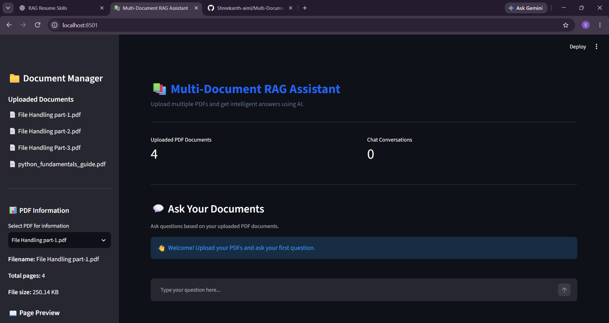

# 📚 Multi-Document RAG Assistant

An AI-powered document question-answering application that allows users to upload multiple PDF files and ask questions using natural language.

The application uses Retrieval-Augmented Generation (RAG) to retrieve relevant information from uploaded documents and generate answers with source references.

## 🚀 Project Overview

The Multi-Document RAG Assistant helps users understand and search information across multiple PDF documents without manually reading every page.

Users can upload PDFs, ask questions, receive AI-generated answers, and view the source document and page number used to generate each answer.

## ✨ Features

- Upload multiple PDF documents.
- Extract text from PDF files.
- Split documents into smaller text chunks.
- Generate embeddings using Sentence Transformers.
- Store document embeddings using FAISS.
- Retrieve relevant content using Maximum Marginal Relevance (MMR).
- Generate answers using the Groq API.
- Display source document names and page numbers.
- Support follow-up questions using conversation history.
- Detect duplicate PDF uploads using SHA-256 hashing.
- View PDF metadata, including filename, page count, and file size.
- Preview extracted text from individual PDF pages.
- Remove uploaded documents and rebuild the vector database.
- Save and download chat history.

## 🛠️ Technologies Used

| Technology            | Purpose                           |
| --------------------- | --------------------------------- |
| Python                | Main programming language         |
| Streamlit             | User interface                    |
| LangChain             | Document processing and retrieval |
| PyPDF                 | PDF text extraction               |
| Sentence Transformers | Text embeddings                   |
| FAISS                 | Vector database                   |
| Groq API              | AI response generation            |
| python-dotenv         | Environment variable management   |

## 🏗️ Project Architecture

```text
User
  |
  v
Streamlit Interface
  |
  v
PDF Upload
  |
  v
Text Extraction
  |
  v
Text Chunking
  |
  v
Embedding Generation
  |
  v
FAISS Vector Database
  |
  v
Question from User
  |
  v
Similarity Retrieval (MMR)
  |
  v
Relevant Document Context
  |
  v
Groq LLM
  |
  v
Answer with Source References
```

## 📂 Project Structure

```text
Multi-Document RAG Assistant/
│
├── app.py
├── document_processor.py
├── embedding_processor.py
├── rag_pipeline.py
├── llm_processor.py
├── requirements.txt
├── README.md
├── .env
├── chat_history.json
│
├── data/
│   └── Uploaded PDF files
│
└── vectorstore/
    └── faiss_index/
        ├── index.faiss
        └── index.pkl
```

## ⚙️ Installation and Setup

### 1. Clone the repository

```bash
git clone YOUR_GITHUB_REPOSITORY_URL
```

### 2. Open the project folder

```bash
cd Multi-Document-RAG-Assistant
```

### 3. Create a virtual environment

```bash
python -m venv venv
```

### 4. Activate the virtual environment

For Windows PowerShell:

```powershell
.\venv\Scripts\Activate.ps1
```

### 5. Install dependencies

```bash
pip install -r requirements.txt
```

### 6. Configure the Groq API key

Create a `.env` file in the project root directory.

Add:

```env
GROQ_API_KEY=your_groq_api_key
```

Replace the placeholder with your own Groq API key.

**Security:** Never upload your `.env` file or API key to GitHub.

### 7. Run the application

```bash
streamlit run app.py
```

The application will open in your browser.

## 💡 How to Use

1. Start the Streamlit application.
2. Upload one or more PDF documents.
3. Process the uploaded documents.
4. Wait for the vector database to be created.
5. Enter a question in the chat interface.
6. Read the generated answer.
7. Expand the source section to view document names, page numbers, and retrieved text.
8. Use follow-up questions to continue the conversation.

## 🔍 Retrieval-Augmented Generation (RAG)

RAG combines information retrieval with language generation.

The application follows these steps:

1. **Document ingestion:** Extract text from uploaded PDF files.
2. **Chunking:** Divide extracted text into smaller sections.
3. **Embedding:** Convert text chunks into numerical vectors.
4. \*\*Storage

## 🖥️ Application Screenshot


